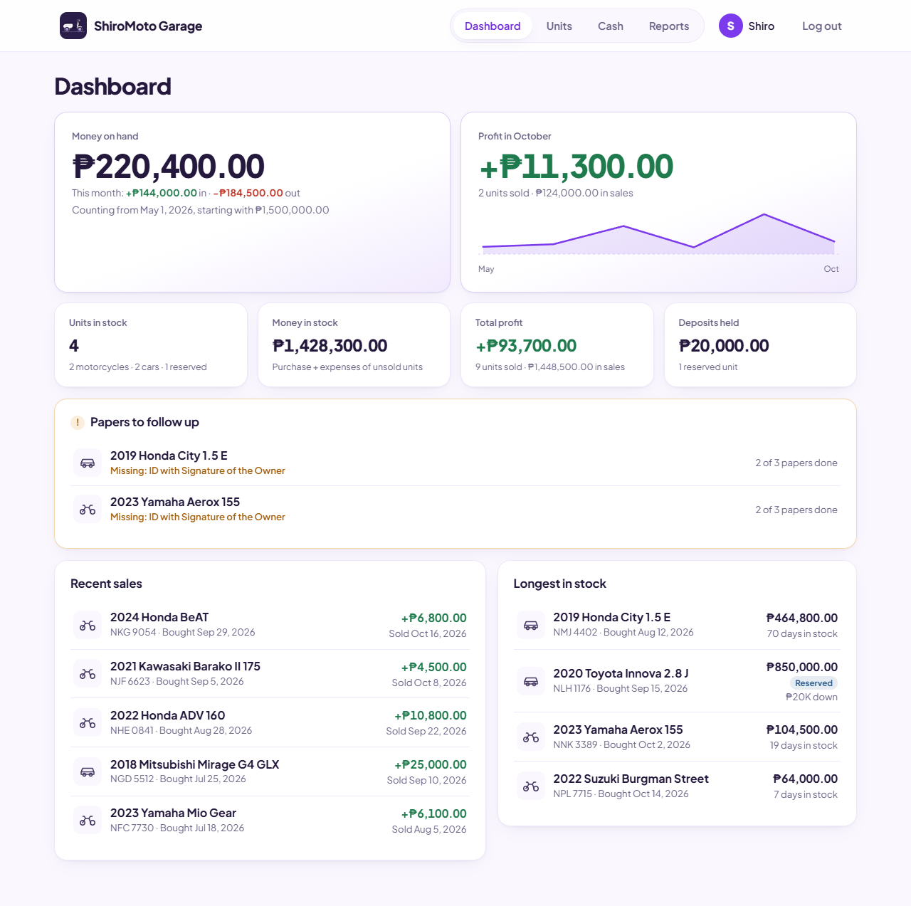
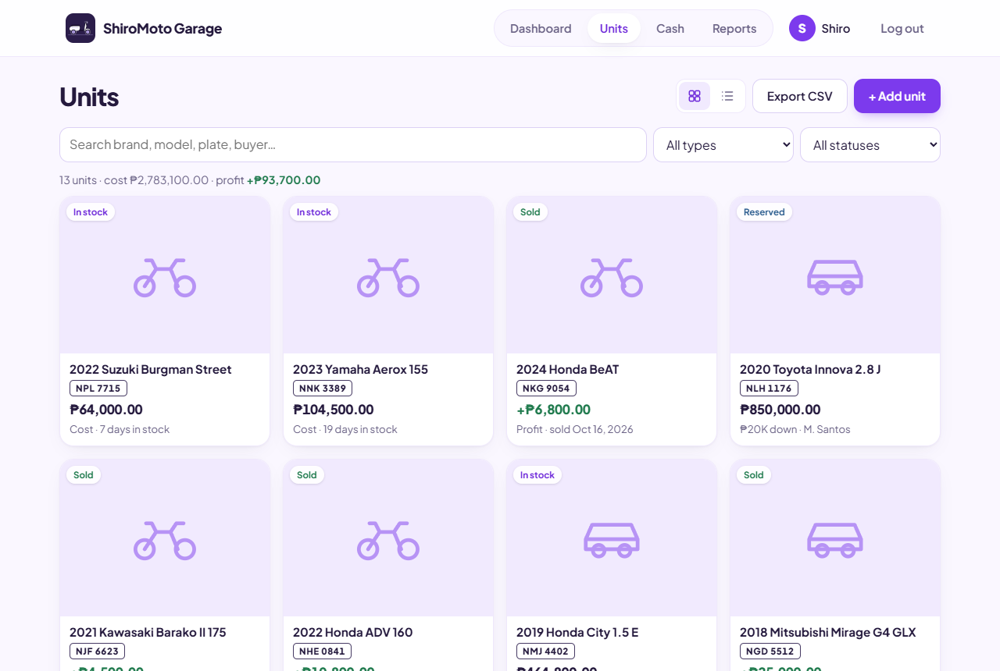
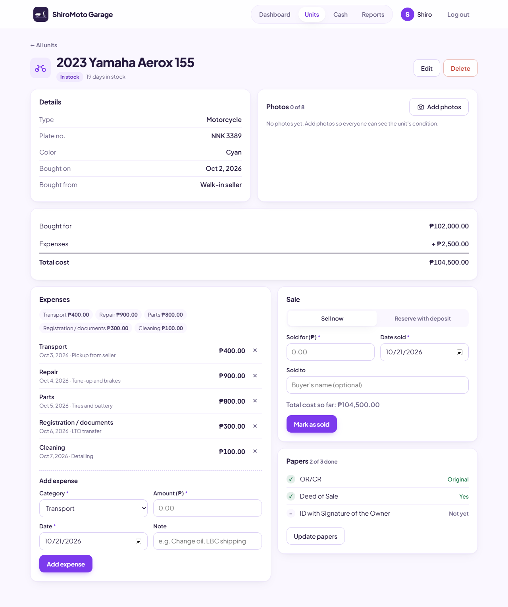
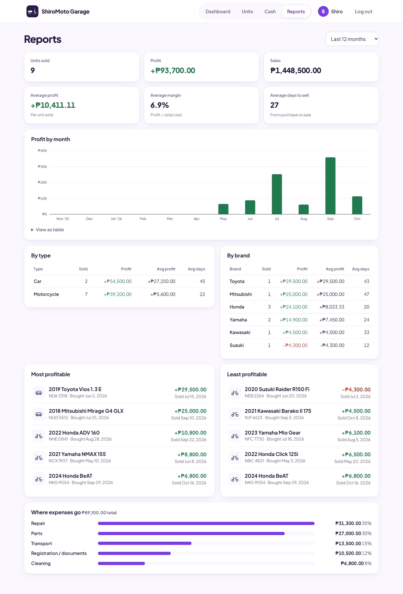
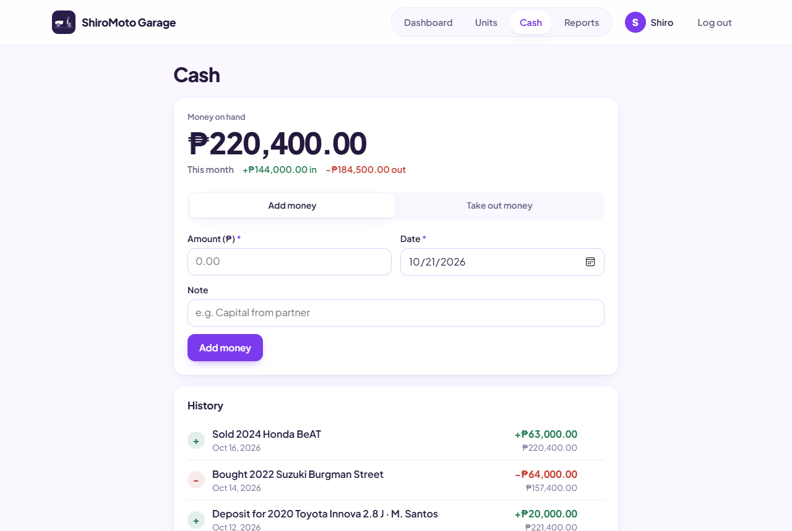
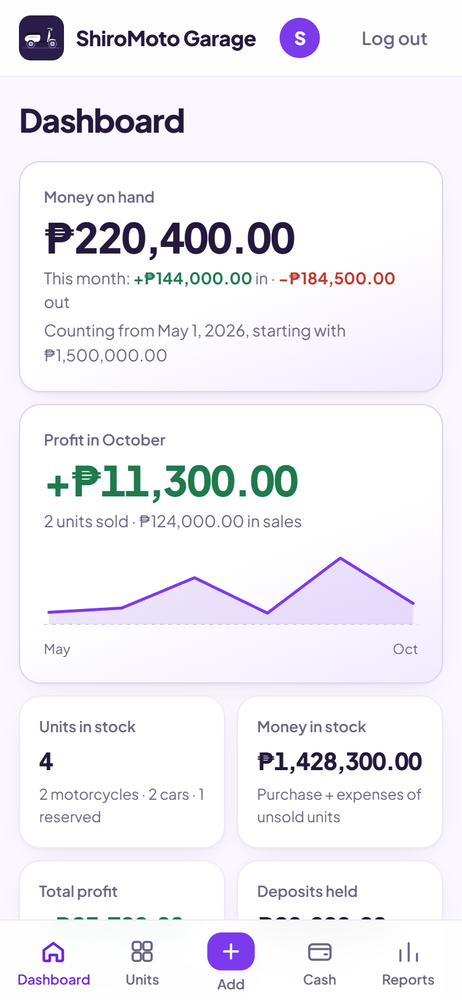
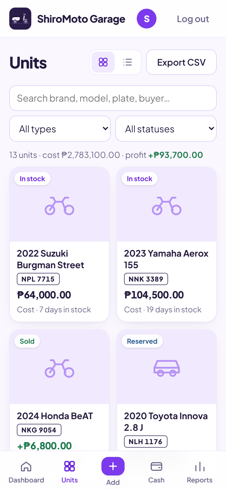
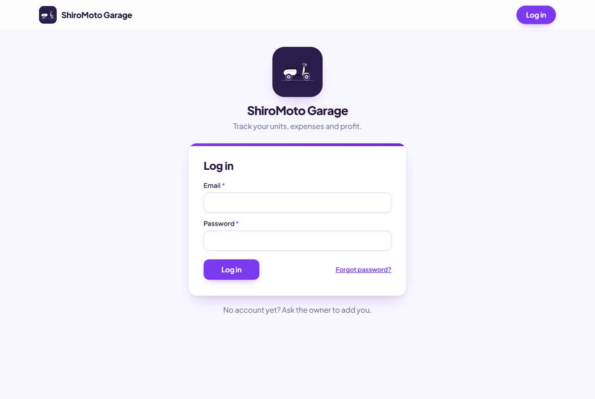
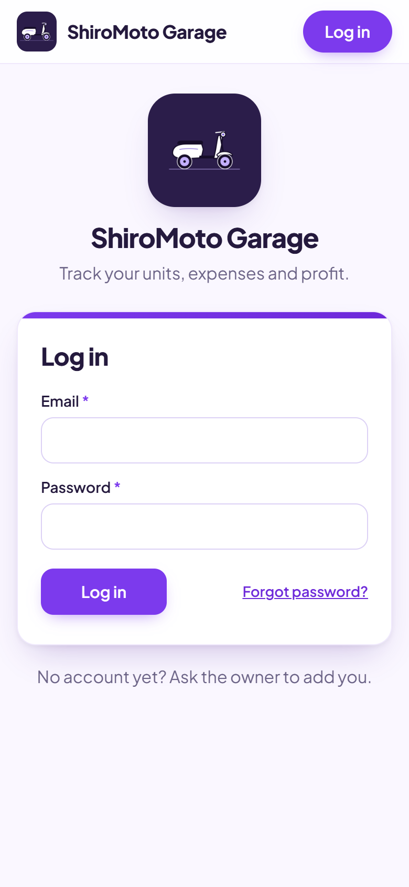

# Moto Garage

A web app for a buy-and-sell business that tracks every motorcycle and car: what it was bought for and when, what was spent on it (transport, repair, parts, documents, cleaning), and what it sold for. It works out the total cost, profit and days in stock for each unit, and shows totals on a dashboard.



- **Dashboard**: units in stock, money tied up in stock, profit this month, total profit, total sales, deposits held, papers to follow up, recent sales, and the units that have been in stock the longest.
- **Units**: each unit's cover photo, search (brand, model, plate, buyer, engine/chassis no.), filters by type and status, plus an **Export CSV** button for Excel or backups.
- **Unit page**: details and a compact row of up to 8 photo thumbnails side by side at the top (tap one to view it full screen, set the cover or delete it), a cost breakdown, expenses, **Sell now** or **Reserve with deposit** (with agreed price and the balance to collect), and a papers summary: OR/CR (original or xerox), Deed of Sale, and ID with Signature of the Owner. Unsold units with missing papers appear on the dashboard.
- **Add / edit unit**: one form for all details, including photos (when adding) and papers, with a **Save** button pinned to the bottom of the screen. Leaving with unsaved changes asks first.
- **Cash**: money on hand. Set your starting money once; after that, buying a unit and adding expenses subtract from it automatically, and deposits and sales add to it. Use **Add money** / **Take out money** for capital, rent, allowance and so on. The full history shows a running balance, and the Add unit form shows money on hand before and after the purchase.
- **Profile** (tap your initial in the top bar): business name, contact number, email and address, shared by the team; the name replaces "ShiroMoto Garage" in the top bar. The ShiroMoto logo and app icons are fixed files in `img/`. Also your own name and a Change password button.
- **Reports**: profit by month (chart and table), average margin and days to sell, profit by type and by brand, the most and least profitable units, and where expenses go. You can view the last 12 months, a single year, or all time.

- Amounts are in Philippine Pesos (₱). Works on phones and computers.

## Screenshots

The screenshots (and the dashboard at the top) use sample data, not real units.

| Units | Unit page |
| --- | --- |
|  |  |

| Reports | Cash |
| --- | --- |
|  |  |

| Dashboard (phone) | Units (phone) |
| --- | --- |
|  |  |

| Login (computer) | Login (phone) |
| --- | --- |
|  |  |

| Top bar | Home screen icon |
| --- | --- |
|  |  |

Photos are shrunk in the browser (about 100–200 KB each) and saved in Firestore, because file storage needs the paid Blaze plan.

Data is stored in **Firebase Firestore** on the free Spark plan (no credit card). Only team members listed in `firestore.rules` can log in and see the data.

- Firebase project: `moto-garage-dmem` ([console](https://console.firebase.google.com/project/moto-garage-dmem/overview))
- Live site: https://moto-garage-dmem.web.app

## Adding a team member

1. Firebase console → **Authentication** → **Users** → **Add user**. Enter their email and a password.
2. Add the same email (lowercase) to the list in [`firestore.rules`](firestore.rules).
3. Deploy the rules:

```sh
npx firebase-tools deploy --only firestore:rules
```

To remove someone, delete them in Authentication and remove their email from `firestore.rules`.

## Run it on your computer

There's no build step. From this folder:

```sh
npx serve .
```

Then open http://localhost:3000. It uses the real Firebase data.

## Publish changes to the live site

```sh
npx firebase-tools deploy
```

This uploads the site to Firebase Hosting and deploys the Firestore rules.

## Free plan limits

The Spark plan is free with no card. The limits are 1 GiB of data, 50,000 reads and 20,000 writes per day, and 10 GB of hosting with 360 MB of downloads per day. That's far more than a small dealer needs. If a limit is ever reached, that service pauses until the daily reset. You are never charged.

## How profit is calculated

```
Total cost = Purchase price + all expenses
Profit     = Sale price − Total cost
```

Each unit stores a running `total_expenses`, which is updated in the same write as each expense is added or deleted. The rest is calculated in `summarize()` in `js/app.js`.

## Files

| File | What it does |
| --- | --- |
| `index.html` | Page shell: top bar, navigation, main view |
| `css/styles.css` | All styles (mobile-first) |
| `js/config.js` | Firebase web config (these values are public) |
| `js/app.js` | Login, pages, forms, saving data, CSV export |
| `firestore.rules` | Who can read and write data (the team email list) |
| `firebase.json`, `.firebaserc` | Firebase Hosting and project settings |
